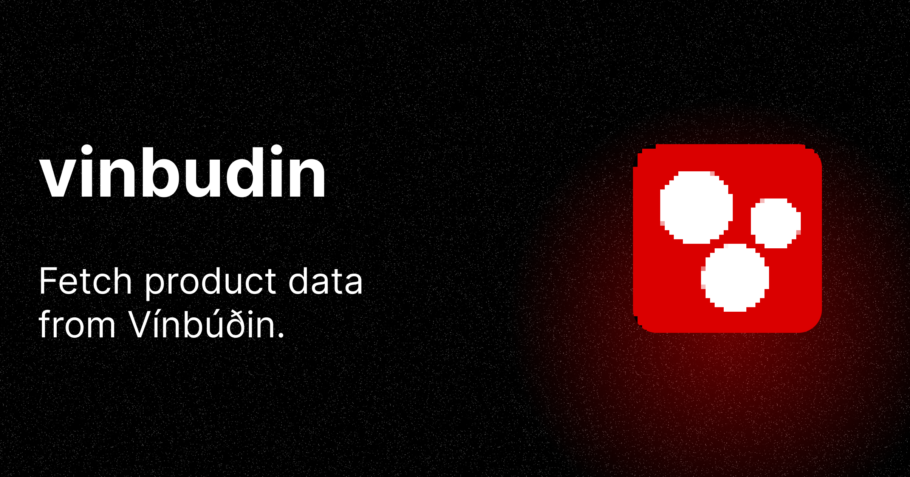

# vinbudin

[![npm version][npm-version-src]][npm-version-href]
[![npm downloads][npm-downloads-src]][npm-downloads-href]
[![License][license-src]][license-href]

> An NPM package to fetch product data from [Vínbúðin](https://www.vinbudin.is/heim).

## Features

- ⚡ Fetch categorized product data from www.vinbudin.is
- 🏷️ Fully typed API
- ✅ Fully validated product data
- 🖼️ Multiple image sizes for optimal performance

## Setup

```bash
# pnpm
pnpm add -D vinbudin

# npm
npm i -D vinbudin

# yarn
yarn add -D vinbudin
```

> [!WARNING]
> This package is native [ESM](https://developer.mozilla.org/en-US/docs/Web/JavaScript/Guide/Modules) and does not provide a CommonJS export. If your project uses CommonJS, you will have to [convert to ESM](https://gist.github.com/sindresorhus/a39789f98801d908bbc7ff3ecc99d99c). Please don't open issues for questions regarding CommonJS / ESM.

## Why?

Vínbúðin does not provide an open API. This package can be used to analyse their product data or create something else from it.

## Basic Usage

```ts
import { getProducts } from 'vinbudin'

getProducts().then((products) => {
  // Handle the data
  console.log(products)
})

// You can also provide an options object to only get specific data
getProducts({
  beer: true,
  bubbly: true,
}).then((products) => {
  // Handle the data
  console.log(products)
})
```

## Example response

```ts
{
  productId: 28304,
  productName: 'Ölverk Sóði Þorrabjór',
  productBottledVolume: 330,
  productAlchoholVolume: 7,
  productPrice: 642,
  productFoodCategories: '',
  productCategory: {
    name: 'beer',
    id: [ '60', '61', '62' ],
    taste: true,
    sweet: false,
    subCategories: null
  },
  productSubCategory: null,
  productCountryOfOrigin: 'ísland',
  productSpecialReserve: false,
  productOrganic: false,
  productContainerType: 'DS.',
  productPlaceOfOrigin: '',
  productDistrictOfOrigin: '',
  productWine: '',
  productInventory: 0,
  productYear: '',
  productDateOnMarket: '2024-01-11T00:00:00',
  productIsTemporaryOnSale: false,
  productIsGift: false,
  productIsInThema: false,
  productIsAvailableInStores: true,
  productIsSpecialOrder: false,
  productStoreSelected: null,
  productTasteGroup: '61BE',
  productTasteGroup2: 'BPALE',
  productTasteGroup2Description: null,
  productPackagingClosing: '',
  productPackagingContainer: 'ALDOS',
  productSpecialMarking: [],
  productSeasonCode: 'ÞORRI',
  minimumQuantity: 0,
  useMinimumQuantityAsUnit: false,
  isSpecialOrderAndOutOfStock: false,
  productSearchGrape: '',
  productProducer: 'Einfalt ehf.',
  productShortDescription: 'Ölverk Sóði Þorrabjór',
  productBackupInventory: 0,
  productPackagingWeight: 6.68,
  productCarbonFootprint: 31.93,
  supplierId: null,
  productAvailableUnits: '24',
  productSaleStatus: '-2',
  productImages: {
    original: 'https://www.vinbudin.is/Portaldata/1/Resources/vorumyndir/original/28304_r.jpg',
    medium: 'https://www.vinbudin.is/Portaldata/1/Resources/vorumyndir/medium/28304_r.jpg'
  }
}
```

## Image Sizes

Each product includes multiple image sizes for optimal performance:

- **`productImages.original`**: Full resolution (384×1417px, ~350KB) - Best for detail views
- **`productImages.medium`**: Optimized resolution (108×400px, ~35KB) - **90% smaller!** Perfect for thumbnails and lists

### Usage Example

```ts
const products = await getProducts({ beer: true })

// Use optimized medium size for thumbnails/lists
const thumbnailUrl = products[0].productImages.medium // 90% smaller!

// Use original for full-quality detail views
const fullResUrl = products[0].productImages.original
```

### Use Cases

- **Thumbnails/Lists**: Use `productImages.medium` for fast loading in product grids
- **Detail Views**: Use `productImages.original` for high-quality product pages
- **Responsive Design**: Load `medium` on mobile, `original` on desktop
- **Progressive Loading**: Display `medium` first, then lazy-load `original`

> [!NOTE]
> This package is designed to be used in a server-side environment. Due to restrictions imposed by browsers regarding cross-origin requests (CORS), attempting to use this package in a client-side (browser) environment may result in errors related to CORS policies.

## Methods

### `getProducts(products) -> promise`

Gets products from www.vinbudin.is

- **products** (Object) is an options object that you can optionally pass in if you want some subset of the data.

It looks like this:

```ts
{
  beer: true,
  red: true,
  white: true,
  rose: true,
  bubbly: true,
  fortified: true,
  ciderfruitandblends: true,
  sakeandmead: true,
  strong: true,
  aromatised: true,
}
```

## Working with client-side environments

While this package is intended for use in server-side environments, such as Node.js applications, there are workarounds available for integrating it into client-side environments.

Both Nuxt and Next.js support API routes as an example:

- [Nuxt API routes](https://nuxt.com/docs/guide/directory-structure/server)
- [Next.js API routes](https://nextjs.org/docs/pages/building-your-application/routing/api-routes)

## Example using Nuxt API routes

```ts
// server/api/vinbudin.ts
import { getProducts } from 'vinbudin'

export default defineEventHandler(async () => {
  return await getProducts({ beer: true });
})

// Component
<script setup lang="ts">
const { data } = await useFetch('/api/vinbudin')
</script>
```

<!-- Badges -->

[npm-version-src]: https://img.shields.io/npm/v/vinbudin/latest.svg?style=flat&colorA=18181B&colorB=28CF8D
[npm-version-href]: https://npmjs.com/package/vinbudin
[npm-downloads-src]: https://img.shields.io/npm/dm/vinbudin.svg?style=flat&colorA=18181B&colorB=28CF8D
[npm-downloads-href]: https://npmjs.com/package/vinbudin
[license-src]: https://img.shields.io/npm/l/vinbudin.svg?style=flat&colorA=18181B&colorB=28CF8D
[license-href]: https://npmjs.com/package/vinbudin
